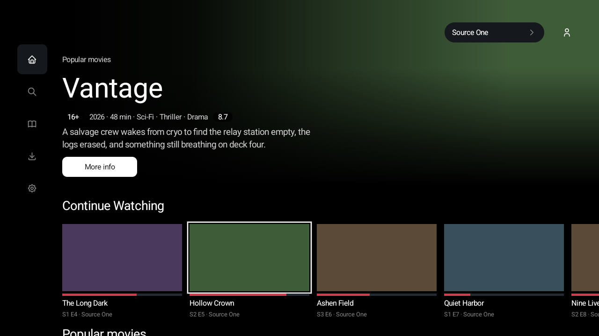
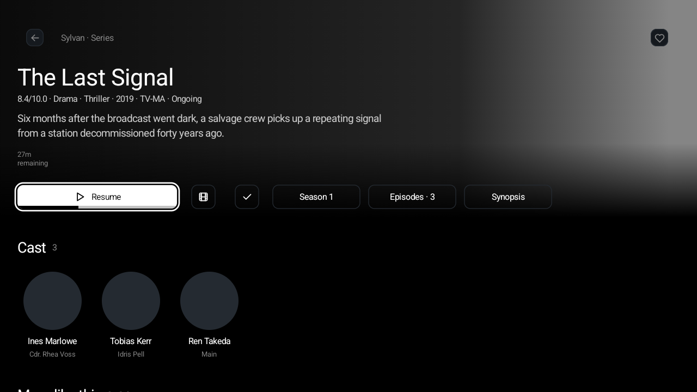
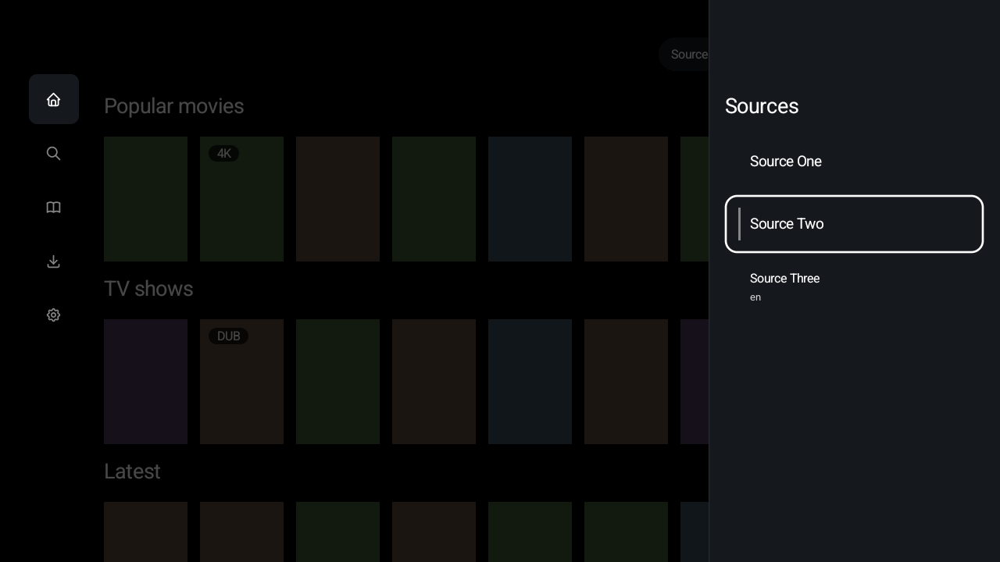
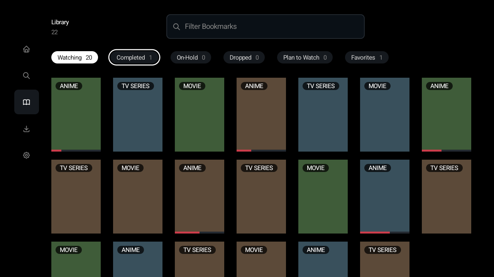

# CloudStream — TV-first redesign (unofficial fork)

**⚠️ Warning: By default, this app doesn't provide any video sources; you have to install extensions to add functionality to the app.**

> **This is an unofficial fork** of [CloudStream](https://github.com/recloudstream/cloudstream) by
> [reCloudStream](https://github.com/recloudstream). It is not affiliated with or endorsed by the CloudStream
> team. The app, its extension system and almost all of its code are theirs; see [About CloudStream](#about_us)
> below for the upstream project.

## Table of Contents: 
+ [About this fork](#about_this_fork)
  + [Platforms](#platforms)
  + [How it's built](#how_built)
  + [Security](#security)
  + [Screenshots](#screenshots)
+ [About CloudStream:](#about_us)
+ [Installation Steps:](#install_rules)
+ [Contributing:](#contributing)
+ [Issues:](#issues)
  + [Bugs Reports:](#bug_report)
  + [Enhancement:](#enhancment)
+ [Extension Development:](#extensions)
+ [Language Support:](#languages)
+ [Further Sources](#contact_and_sources)

## About this fork

This repository exists to try two things on top of CloudStream:

1. **A redesign, platform by platform.** Android TV comes first, then a Mac desktop app, then phone and tablet.
   Each platform gets the design that suits it best: focus and a remote on TV, a pointer, keyboard shortcuts and
   resizable windows on the Mac, touch on the phone. The screens differ; the logic behind them is shared.
2. **A move to Kotlin Multiplatform and Compose.** The app is being carved out of one large Android module into
   small shared modules, so the same state, data and logic can run on Android, on desktop and, later, on iOS.

Extensions keep working throughout. The extension API that third-party extensions compile against is treated as a
fixed contract and checked on every change.

### Platforms

| Platform | Status |
|---|---|
| **Android TV** | Redesigned. Home, Search, Library, the title page, Downloads and the player's controls are new Compose screens. The old screens stay in the code as a fallback for now. |
| **Mac desktop** | A working app: Home, Search, Library, the title page and playback. Extensions run in a sandbox (below), and video plays through the VLC installed on the Mac. The Downloads pages are built but not yet in the app's window. |
| **Phone and tablet** | Planned. Phones still show CloudStream's existing design. |

There are no release builds of this fork yet.

### How it's built

- `:app` is the Android app. It shrinks as code moves out of it.
- `:library` is the extension API that extensions are built against. It stays published and compatible.
- `:core:*` holds shared building blocks: theme and design system, strings, storage, networking.
- `:feature:*` holds one module per feature (home, search, library, detail, downloads, player, extensions), each with
  shared logic and a screen per platform.
- `:media:*` holds playback and download contracts, subtitles and the download engine.
- `:desktopApp` is the Mac app.

The full plan, the rules between modules and the reasons behind them are in
[docs/plans/kmp-migration.md](docs/plans/kmp-migration.md). The desktop's design choices are in
[docs/plans/desktop-design.md](docs/plans/desktop-design.md).

### Security

Extensions are third-party code, so this fork treats what they do and return as untrusted.

- **Sandboxed extensions on the Mac.** Each extension is hashed and scanned before it loads, then runs in its own
  macOS sandbox process, never inside the app. Video decoding runs in its own sandboxed process too, one per stream.
  Where no sandbox is available, nothing loads. On Android, extensions still run inside the app process, as in
  upstream; only the desktop sandboxes them.
- **No secrets in logs.** The app's own log lines, crash files and error messages no longer carry stream links,
  request headers, cookies, tokens, repository URLs or file paths (`BUG-43`, `BUG-44` in [docs/tasks/defects.md](docs/tasks/defects.md)).
- **Sign-ins and stored links.** A deleted profile's sign-ins no longer pass to the next profile (`BUG-48`).
  Sign-ins are kept out of Android's cloud backup and device-to-device transfer (`BUG-50`). The Android downloader no longer stores stream links (`KMP-62` in [docs/tasks/kmp.md](docs/tasks/kmp.md)).
- **TLS stays on.** Playback no longer turns off certificate checks for the whole app (`BUG-10`).

### Screenshots

Android TV. These are the screenshot tests' reference images, taken on a 720p TV emulator with made-up titles and
placeholder artwork.

| | |
|---|---|
|  |  |
| **Home** | **Title page** |
|  |  |
| **Choosing a source** | **Library** |

Mac screenshots are coming.

## About CloudStream: 

Upstream CloudStream's Discord: 

**CloudStream is a media center that prioritizes and emphasizes complete freedom and flexibility for users and developers.** 

CloudStream is an extension-based multimedia player with tracking support. There are extensions to view videos from: 

+ [Librevox (audio-books)](https://librivox.org/) 
+ [Youtube](https://www.youtube.com/)
+ [Twitch](https://www.twitch.tv/)
+ [iptv-org (A collection of publicly available IPTV (Internet Protocol television) channels from all over the world.)](https://github.com/iptv-org/iptv) 
+ [nginx](https://nginx.org/)
+ And more... 

**Please don't create illegal extensions or use any that host any copyrighted media.** For more details about our stance on the DMCA and EUCD, you can read about it on our organization: [reCloudStream](https://github.com/recloudstream)

#### Important Copyright Note: 

Our documentation is unmaintained and open to contributions; therefore, apps and sources, extensions in recommended sources, and recommended apps are not officially moderated or endorsed by CloudStream; if you or another copyright owner identify an extension that breaches your copyright, please let us know. 

#### Features:
+ **AdFree**, No ads whatsoever
+ No tracking/analytics
+ Bookmarks
+ Phone and TV support
+ Chromecast
+ Extension system for personal customization

## Installation: 

CloudStream's documentation provides the steps to install and configure the official app. This fork has no
release builds of its own yet.

[Getting Started With CloudStream:](https://recloudstream.github.io/csdocs/)

## Contributing:
For the upstream app, the CloudStream team **happily** accepts contributions; to find out where you can start, look
[at their issues tab](https://github.com/recloudstream/cloudstream/issues). Work on this fork's redesign, desktop app
or migration belongs in this repository; the live task list is in [docs/tasks](docs/tasks/README.md).

 
 
### Issues: 
Problems with this fork's new screens or the desktop app belong in this repository's issues. Problems that also
happen in the official app belong upstream, where the CloudStream team asks you to fill out a [template](https://github.com/recloudstream/cloudstream/issues/new/choose). These include the following:

- [Bug Report Template: ](https://github.com/recloudstream/cloudstream/issues/new?assignees=&labels=bug&projects=&template=application-bug.yml)
  - For bug reports, we want as much info as possible, including your downloaded version of CloudeStream, device and updated version (if possible, current API),
    expected behavior of the program, and the actual behavior that the program did, most importantly we require clear, reproducible steps of the bug. If your bug can't be       reproduced, it is unlikely we'll work on your issue.
    

  
- [Feature Request Template: ](https://github.com/recloudstream/cloudstream/issues/new?assignees=&labels=enhancement&projects=&template=feature-request.yml)
  - Before adding a feature request, please check to see if a feature request already has been requested.  

### Extensions:
 
**Further details on creating extensions for CloudStream are found in our documentation.**

[Guide: For Extension Developers](https://recloudstream.github.io/csdocs/devs/gettingstarted/) 

## Further Sources: 

As well as providing clear install steps, our [website](https://dweb.link/ipns/cloudstream.on.fleek.co/) includes a wide variety of other tools, such as: 
- [Troubleshooting](https://recloudstream.github.io/csdocs/troubleshooting/)
- [Further CloudStream Repositories](https://recloudstream.github.io/csdocs/repositories/) 
- Set-Up for other devices, such as:
  - [Android TV](https://recloudstream.github.io/csdocs/other-devices/tv/)
  - [Windows](https://recloudstream.github.io/csdocs/other-devices/windows/)
  - [Linux](https://recloudstream.github.io/csdocs/other-devices/linux/)
- And more...

  

### Supported languages:

Upstream CloudStream's translations are managed on Weblate; this fork's new strings are machine-translated and waiting on native review ([docs/tasks/i18n.md](docs/tasks/i18n.md)). Even if you can't contribute to the code or documentation, we always look for those who can contribute to translation and language support. Your contribution is exceptionally appreciated; you can check our translation from the figure below. 

## License

GPL-3.0, as upstream; see [LICENSE](LICENSE). The vendored Mihon code is Apache-2.0; see [NOTICE](NOTICE).
